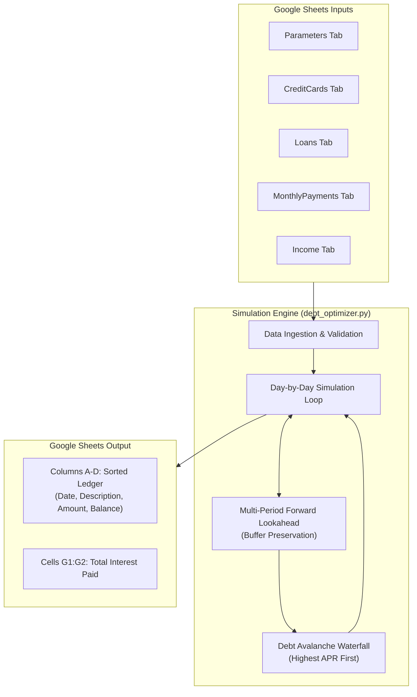
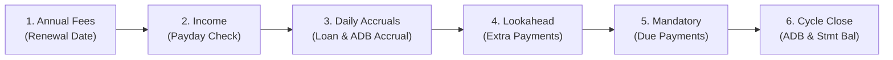
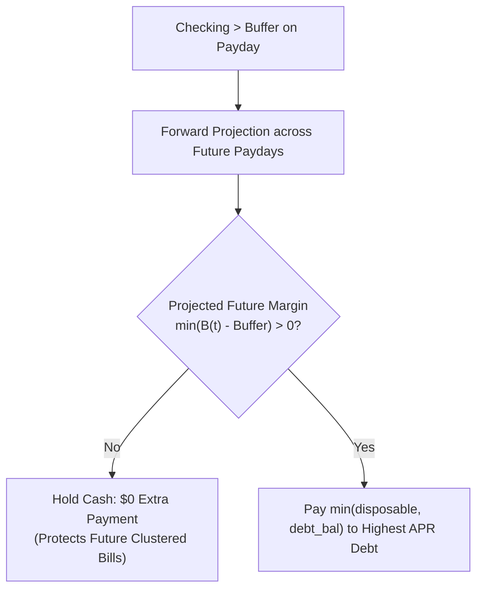

# Debt Minimizer & Cash Flow Payment Schedule Optimizer

A deterministic, day-by-day personal finance simulation and debt optimization engine. It models complex credit card statement cycles, daily simple interest loan accruals, biweekly income, and recurring bills to construct an aggressive debt avalanche payment schedule while mathematically guaranteeing your checking account never breaches a designated buffer.

---

## Architecture & Workflow

### 1. High-Level System Architecture



### 2. Daily Simulation Cycle



### 3. Multi-Period Liquidity Protection



---

## Setup & Installation

### 1. Clone & Environment Setup

```bash
# Clone repository
git clone https://github.com/osaesm/DebtMinimizer.git
cd DebtMinimizer

# Create and activate virtual environment
python3 -m venv venv
source venv/bin/activate

# Install required dependencies
pip install -r requirements.txt
```

### 2. Google Cloud API Access

1. Open [Google Cloud Console](https://console.cloud.google.com/).
2. Create a project (e.g., `Debt-Optimizer`).
3. Under **APIs & Services > Library**, search for and enable:
   - **Google Sheets API**
   - **Google Drive API**
4. Under **APIs & Services > OAuth consent screen**:
   - User Type: **External**.
   - Fill in App Name and support email.
   - Add scopes: `https://www.googleapis.com/auth/spreadsheets` and `https://www.googleapis.com/auth/drive`.
   - Under **Test users**, add your personal Google account email address.
5. Under **APIs & Services > Credentials**:
   - Click **+ Create Credentials > OAuth client ID**.
   - Application type: **Desktop app**.
   - Download the client secret JSON.
6. Rename the file to `credentials.json` and save it directly in the project root:
   ```bash
   mv ~/Downloads/client_secret_*.json ./credentials.json
   ```

---

## Google Sheet Schema

Create a Google Spreadsheet named `Debt Optimization Sheet` (or pass a custom name via `--sheet`) containing the following tabs and headers:

| Tab | Required Column Headers | Description |
| :--- | :--- | :--- |
| **`Parameters`** | `Start Date`, `End Date`, `Initial Checking Balance`, `Checking Buffer` | Simulation date range and cash floor. |
| **`CreditCards`** | `Card`, `Issuer`, `APR`, `Balance`, `Promo Balance`, `Promo End Date`, `Statement Cycle End Day`, `Statement Balance`, `Grace Active`, `Due Day`, `Grace Period Days`, `Cycle End Nth Weekday`, `Min Floor`, `Annual Fee`, `Renewal Date` | Supports Chase, Citibank, Amex, Capital One, Discover, and X1 rules. |
| **`Loans`** | `Name`, `Amount Left`, `APR`, `Minimum Payment`, `Due Day` | Simple interest installment loans. |
| **`MonthlyPayments`** | `Name`, `Amount`, `Due Day` | Recurring non-debt bills (rent, utilities, etc.). |
| **`Income`** | `Start Date`, `Paycheck 2`, `Paychecks 1 and 3` | Biweekly pay schedule (14-day cycle). |

### Output Tab
The script generates an **`Output`** worksheet:
- **Columns A–D**: Full chronological transaction ledger (`Date`, `Description`, `Amount`, `Checking Balance`).
- **Cell G1**: Label `"Total Interest Paid"`.
- **Cell G2**: Total dollar amount of interest paid over the entire simulation period.

---

## Usage

### Run Offline Mathematical Verification Test Suite
```bash
# Run standalone test runner
python test_debt_optimizer.py

# Or via CLI flag
python debt_optimizer.py --test
```

### Run Simulation Against Google Sheets
```bash
# Default (looks for 'Debt Optimization Sheet' and 'credentials.json')
python debt_optimizer.py

# Custom sheet name or credentials path
python debt_optimizer.py --sheet "My 2026 Debt Plan" --creds my_creds.json

# Fallback: Service Account Authentication
python debt_optimizer.py --sheet "My 2026 Debt Plan" --service-account service_account.json
```

On first run, your browser opens to authorize OAuth 2.0 access. A cached `token.json` is generated for headless execution on subsequent runs.

---

## Test Coverage & Mathematical Verification

The simulation engine is backed by a 36-scenario test suite in `test_debt_optimizer.py` verifying edge cases, complex issuer rules, and liquidity preservation.

### Coverage Summary

| Metric | Result |
| :--- | :--- |
| **Test Suite Pass Rate** | **36 / 36 (100%)** |
| **Core Engine (`debt_optimizer.py`)** | **~99% of engine logic** *(68% file total; remaining 32% is interactive Sheets API I/O)* |
| **Test File (`test_debt_optimizer.py`)** | **99%** |
| **Combined Codebase Coverage** | **78%** |

### Test Breakdown

- **Baseline Tests (1–9)**: Chase/Amex minimum payment formulas, Citibank cycle end calculation, promotional balance expirations, grace loss and retroactive interest, checking buffer dips, 3-paycheck months (May 2026), and debt avalanche lookaheads.
- **Extended Issuer & Amortization Tests (10–32)**: Discover 20 + Interest + Fees rule, CapOne/Citi/X1 formulas, sub-floor balances, zero/negative balances, Amex 2% principal dominance, December/January cycle rollovers, leap-year and month-end clamping (Feb 28 / Apr 30), annual fee billing, early loan payoffs, and lingering average daily balance (ADB) interest.
- **Engine Guards & Liquidity Protection (33–36)**:
  - **Test 33**: Out-of-bounds Citibank weekday loop guard (`ValueError`).
  - **Test 34**: Card/issuer dynamic retroactive grace penalty calculation.
  - **Test 35**: Simple interest loan accrual verifying non-compounding principal.
  - **Test 36**: Multi-period forward cash-flow projection preventing buffer breaches across clustered-expense periods.
